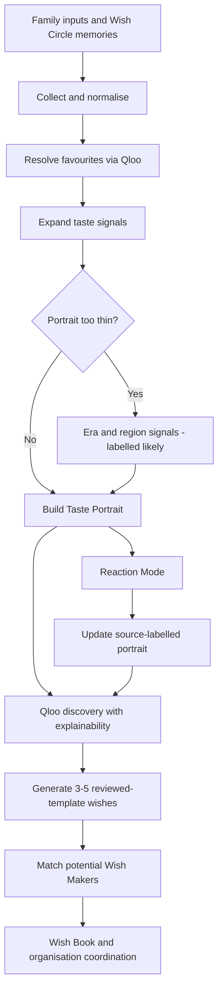
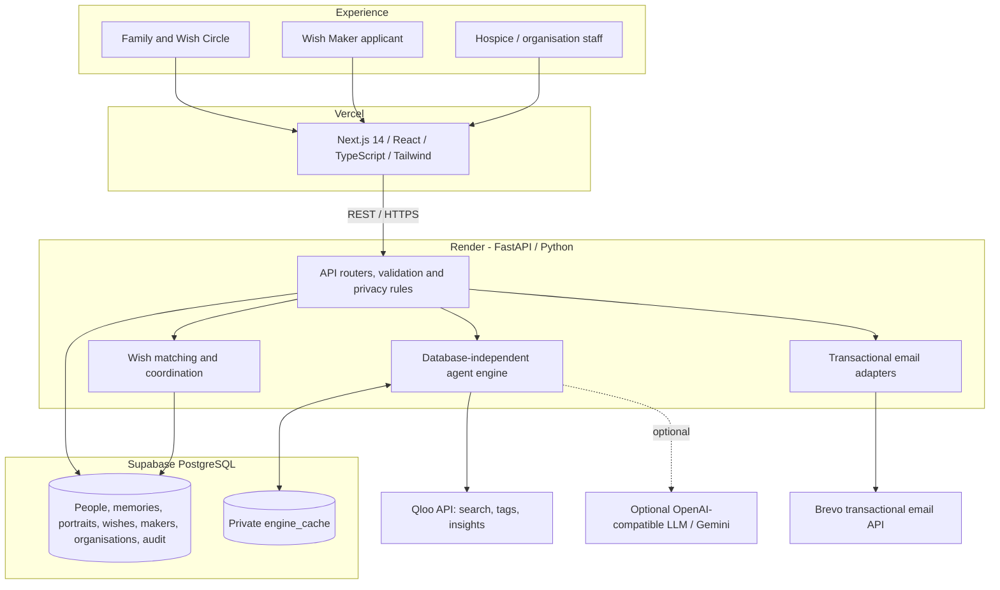

Genie ✨
Everyone deserves to be known before they go.
A Qloo-powered agentic platform for discovering meaningful last wishes and helping families, Wish Makers, and care organisations work towards making them happen.

Built for the Qloo Agentic Hackathon — Agents, but with taste.

Explore the live demo · API documentation · Source code

Demo notice: Nani, Sana, and the sample Wish Makers are fictional. The organisation portal and matching workflows are implemented, but no real hospice partnership or real-world wish fulfilment is claimed. Genie is not a medical service. The free Render backend may take up to ~90 seconds to wake.

Why Genie?
A final wish is not always a grand adventure. It might be hearing a childhood song again, tasting a familiar recipe, seeing photographs of a beloved place, or receiving a story from someone who understands what that place meant.

Families often hold different fragments of a person's life. Genie helps bring those fragments together, discovers relevant possibilities through Qloo's taste intelligence, and creates a pathway from memory → personal wish → potential human connection. It starts with what someone loved, not their condition.
Experience at a glance
Stage	What happens
Start a story	Enter a first name or nickname, era/region/language, and a few favourites. No medical records required.
Wish Circle	Friends and family add memories through a private, consent-based link without an account.
Taste Portrait & Taste Map	Genie resolves favourites through Qloo entities/tags and builds a source-labelled portrait.
Wish discovery	The agent suggests 3–5 personal wishes, including an explicitly labelled Qloo-based discovery where available.
Wish Network	Wishes are matched with potential musicians, cooks, storytellers, and other Wish Makers, with reasons visible.
Wish Book	Compile a keepsake, print/save as PDF, share privately, and revoke sharing.
Organisation portal	Approved organisations can coordinate stories through permissioned roles and case workflows.

Other built experiences include Reaction Mode (gentle lit up / no reaction feedback), a non-clinical Bedside Kit, Watch Genie Learn (real agent steps and friendly Qloo call logs), Qloo receipts on wishes, a How Genie uses Qloo evidence page, and a fair Genie vs General AI comparison using the same supplied facts.
Try the fictional demo
1. Open the live site and choose Explore the demo.
2. Follow Nani's guided story or explore Sana's story. Each pinned demo has three fictional Wish Circle contributions.
3. Inspect the portrait, wishes, source labels, Qloo receipt, Wish Network, and Wish Book.
4. Visit How Genie uses Qloo and the hospice walkthrough to see the intelligence and coordination layers.
Do not enter real people's private or medical information into this hackathon demo.
What is a hospice, and why does Genie have a portal?
A hospice is a care service focused on comfort, dignity, and quality of life for people nearing the end of life. Genie's hospice portal is not a medical record system or clinical decision tool. It is an already-built organisation coordination layer for managing consented stories and helping staff and volunteers follow up on wishes.

Implemented organisation capabilities include:
- Organisation application, administrative review, and approval/rejection workflows.
- Private organisation/member links and roles such as coordinator, volunteer, and viewer (read-only).
- Consent confirmation before opening a story; opaque case identifiers rather than public personal listings.
- Organisation dashboard, case management, expiry extensions, deletion, and activity/audit records.
- Invitation and notification emails for applications, approvals, and team members.
Status: the portal and backend workflows exist today. Real hospice onboarding, operational validation, and human-supervised pilots are next steps—not features we are claiming to have completed.
How Qloo powers Genie
Qloo is the agent's cultural/taste intelligence, not a decorative API call.
Qloo's job	Implementation	Visible product evidence
Understand	Resolve favourites through Qloo search/entities and taste tags; expand the portrait with connected taste information.	Taste Portrait, Taste Map, source and resolution labels.
Discover	Use Qloo Insights with explainability to find related interests, and era/region signals when the supplied portrait is thin.	Clearly marked discovery wish, supporting anchors, Qloo receipt.
Match	Compare wish signals with potential makers using shared Qloo entity IDs and taste tags, with a plain-name fallback distinguished from Qloo-based evidence.	Wish Network and match reasons.
Learn	Use positive reactions to adjust portrait evidence and explore related possibilities.	Reaction Mode and updated portrait.

Agent workflow

backend/engine/ is a plain-Python, database-independent engine. The FastAPI layer invokes it and persists the returned portrait, wishes, steps, and logs. The UI shows actual counts, cache hits, errors, and friendly call labels rather than a fabricated reasoning animation.
Six-level resolution and honesty ladder
1. Exact Qloo entity match.
2. Alternate spelling or alias.
3. Relevant parent entity, such as a song's artist, a cuisine, or a place's parent.
4. Era/region-based possibilities if the portrait is thin—labelled likely, not remembered.
5. Item not found in Qloo—preserved and labelled, excluded from Qloo scoring.
6. Qloo error/timeout—use a private cached answer where possible or return a calm unavailable state.
Items distinguish Told by family, They reacted to this, Likely from their era and region, and Suggested by AI, not in Qloo. A discovery is a suggestion, not a claim about what the person definitely loved. The optional LLM supports free-text interpretation and comparison; the core agent works without it. Wish text defaults to reviewed templates rather than uncontrolled generation.
System architecture

Separation of concerns: the frontend renders the experience; the backend owns persistence, access, consent, organisation and maker workflows; the engine owns taste resolution, discovery, reactions and wish generation. Qloo's raw response data and cache are not published in the repository.
Where Brevo fits
Genie uses Brevo's transactional email API (https://api.brevo.com/v3/smtp/email) for communication—not for generating wishes or providing taste intelligence.
- Wish Maker workflow: application acknowledgment with a private status/profile link, administrator notification, review decisions, wish requests, acceptance/decline notifications, and private-link recovery.
- Organisation workflow: application receipt, administrator alert, approval with a private portal link, and role-specific member invitations.
- Implementation: backend/mailer.py handles maker/family messages; backend/org_mail.py handles organisation messages. Both use BREVO_API_KEY, a verified sender, and FRONTEND_URL for deployed-site links.
- Failure behaviour: sending failures are logged and return a failure result; a mail outage must not crash an application or approval operation. Email delivery and links still require manual end-to-end verification with real inboxes.
The email channel is optional for local exploration, but must be correctly configured for live onboarding and notifications.
Tech stack
Layer	Technologies
Frontend	Next.js 14, React 18, TypeScript, Tailwind CSS, Vitest
API/backend	Python, FastAPI, psycopg, httpx
Agent	Plain Python, Qloo API (search/tags/Insights), optional OpenAI-compatible LLM/Gemini
Database	Supabase PostgreSQL; private engine_cache table
Email	Brevo transactional email API
Hosting	Vercel (frontend), Render (backend)
Development	GitHub, SQL migrations, automated and live checks

Repository map
Genie/
├── frontend/                 # Family, demo, Wish Book, maker and organisation UI
├── backend/
│   ├── engine/               # Qloo client, resolver, portrait, agent, wishes, reactions
│   ├── routers/              # REST endpoints and product workflows
│   ├── migrations/           # Database changes (001-009)
│   ├── mailer.py             # Wish Maker and family transactional emails
│   ├── org_mail.py           # Organisation transactional emails
│   ├── matcher.py            # Wish-to-maker matching
│   ├── engine_cache_store.py # Private Qloo cache persistence
│   ├── post_deploy_check.py  # Production smoke test
│   └── refresh_demo_sources.py # Idempotent pinned-demo data refresh
├── docs/                     # Engine, API contract, privacy, deployment and reports
├── design/                   # Design system, copy and wireframes
└── README.md
The authoritative data shapes are in [`docs/engine-contract.md`](docs/engine-contract.md); deeper implementation notes are in [`docs/Engine.md`](docs/Engine.md) and [`docs/devpost-technical-notes.md`](docs/devpost-technical-notes.md).
Run locally
Requirements: Python 3.11+, Node.js/npm, a Supabase PostgreSQL project, and a Qloo key for live taste resolution. Keep keys in local .env files or host settings; never commit them.
Backend (PowerShell)
cd backend
python -m venv venv
.\venv\Scripts\Activate.ps1
python -m pip install -r requirements.txt
Copy-Item .env.example .env
# Fill backend/.env with your own configuration
Run backend/schema.sql followed by the SQL files in backend/migrations/ in numerical order in the Supabase SQL Editor. Then, from backend/:
python engine_cache_store.py init
python seed.py
python enrich_makers.py
uvicorn main:app --reload
seed.py installs fictional sample Wish Makers. enrich_makers.py requires appropriate Qloo configuration. Open http://127.0.0.1:8000/docs for interactive API documentation.
Frontend (second terminal)
cd frontend
Copy-Item .env.example .env.local
# Set NEXT_PUBLIC_API_URL=http://127.0.0.1:8000 in .env.local
npm install
npm run dev
Open http://localhost:3000. To validate the frontend:
npm run typecheck
npm test
npm run build
Backend environment variables
Variable	Purpose
DATABASE_URL	Supabase session-pooler PostgreSQL connection string.
QLOO_API_KEY, QLOO_API_URL	Qloo key and https://hackathon.api.qloo.com.
LLM_API_KEY, LLM_MODEL, LLM_BASE_URL	Optional OpenAI-compatible LLM configuration.
ALLOWED_ORIGINS	Allowed frontend origins, comma-separated, without trailing slashes.
FRONTEND_URL	Public frontend base URL used to construct email links.
BREVO_API_KEY	Brevo API credential for transactional email.
MAIL_FROM_EMAIL, MAIL_FROM_NAME	Verified sender email and display name.
ADMIN_TOKEN, ADMIN_EMAIL	Administrative access and notification recipient.
DEMO_TTL_DAYS, DEMO_PERSON_IDS	Demo expiry and pinned fictional demo IDs.
WISH_POLISH, ENGINE_CACHE_RESTORE	Optional wish rewrite and private cache restoration switches.

See [`docs/deployment.md`](docs/deployment.md) for hosting and email configuration. In production, set both FRONTEND_URL and ALLOWED_ORIGINS to the correct Vercel address; check Brevo sender verification and any authorized-IP restrictions.
Testing and current deployment status
The project has documented coverage and reliability checks:
- 40-input Qloo coverage set: 38 direct/automatic resolutions; all 40 handled truthfully through the fallback ladder. This does not mean 40 direct entity matches.
- 12/12 fictional people completed the documented local judge journey with zero failed checks.
- 43/43 odd-input/outage checks passed in the documented engine evaluation.
- 213 offline engine checks, 8 cache-store checks, and 162 frontend tests reported in the project test evidence.
- Production smoke test, independently rerun on October 30, 2026: 25 passed, 0 failed, including API/database, CORS, both pinned demo journeys, portrait items, Qloo labels, Wish Book and three family voices per persona.
From backend/, run the production smoke test:
python -m pip install requests
python .\post_deploy_check.py https://genie-ld8p.onrender.com --origin https://genie-smoky-iota.vercel.app
This test creates and deletes temporary fictional demo copies. It is not a substitute for manually submitting an organisation and Wish Maker application and confirming that their emailed private links open the deployed frontend rather than localhost.

For additional test commands, see [`docs/testing.md`](docs/testing.md), or run the offline suites in backend/engine/ and backend/test_cache_store.py. The complete fictional-person API journey is in backend/judge_test.py.
Privacy, dignity and responsible use
- Minimal personal details: first name/nickname, birth year, region, language and favourites; no medical records required.
- Private Wish Circle links, contributor consent, bounded inputs, revocable Wish Book sharing, configurable expiry, and deletion of linked personal-story records.
- Organisation cases use private identifiers, access roles, consent confirmation and audit records.
- Every inferred interest is visibly separated from family-provided or reaction-confirmed evidence.
- Qloo receives favourite names; an optional LLM may receive the relevant taste inputs, and the comparison may receive the same family-supplied facts and notes as Genie. Read the consent notice and [`docs/privacy.md`](docs/privacy.md) before use.
- Qloo response data and cache files are not committed publicly. The private cache is stored separately in Supabase and should not be mistaken for the personal-story records deleted through the person deletion flow.
- Reaction Mode and Bedside Kit are comfort/connection features, not diagnosis, treatment or medical advice. Food or bedside activities must be checked with the care team.
Built today vs. next steps
Already implemented	Requires real-world partners / further validation
Family journey, Wish Circle, Taste Portrait, agent, wish generation and Wish Book	Testing with consenting families and hospice professionals
Qloo discovery, receipts, call log, reaction and comparison experiences	Broader cultural and multilingual evaluation
Sample Wish Maker matching, application/review/request/reply workflows	Verified real Wish Makers, identity checks, availability and human oversight
Hospice organisation portal, approval, roles, case management and audit	Real organisation onboarding and supervised pilot procedures
Brevo email integration	Manual delivery/link verification and operational support

The core product infrastructure exists. The next milestone is connecting it responsibly with real organisations and verified contributors so families can pursue actual wishes. We do not claim current hospice partnerships, verified live Wish Makers, or completed real-world fulfilments, and no wish is guaranteed.
Team
Contributor	Role and contributions
Syeda Alizah	Team lead · Frontend & product experience. Next.js/React UI, family and demo journeys, visual design, Wish Book and hospice-facing frontend, product copy and integration.
Syeda Umaima	Agent & Qloo engine. Taste resolution, portrait and wish generation, Qloo client/Insights, fallback ladder, Reaction Mode, Bedside Kit, comparison, reliability and engine evaluation.
Zunairah	Backend, data, privacy & deployment. FastAPI, Supabase schema and migrations, Wish Circle, maker and organisation workflows, matching integration, Brevo email, privacy, hosting and production-demo refresh.

Documentation
- [`docs/Engine.md`](docs/Engine.md) — Qloo engine and reasoning flow.
- [`docs/engine-contract.md`](docs/engine-contract.md) — frontend/backend/engine data contracts.
- [`docs/devpost-technical-notes.md`](docs/devpost-technical-notes.md) — Qloo evidence and honest limitations.
- [`docs/privacy.md`](docs/privacy.md) — data handling and deletion details.
- [`docs/deployment.md`](docs/deployment.md) and [`docs/testing.md`](docs/testing.md) — deployment and verification.
- [`docs/umaima-engine-report-days-1-9.md`](docs/umaima-engine-report-days-1-9.md) and [`docs/detailed_backend_report_zunairah.md`](docs/detailed_backend_report_zunairah.md) — engineering work reports.
License
MIT — see LICENSE.

<strong>Because a lifetime is more than a list of facts. It is everything someone loved.</strong>

